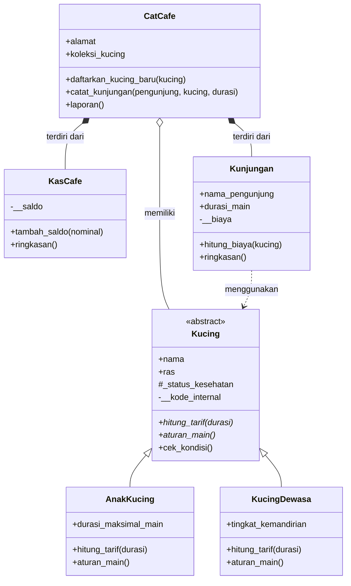

# PurrBook: Sistem Booking dan Kunjungan Cat Cafe

Program ini dibuat menggunakan Python untuk latihan OOP. Program digunakan untuk mengelola data kucing, kunjungan pengunjung, dan kas kafe "Cat Space Princess" lewat menu di terminal.

## Class Diagram



**Asosiasi (Kunjungan ke Kucing).** Method `Kunjungan.hitung_biaya(kucing)` menerima objek `Kucing` lewat parameter dan memakainya sementara untuk menghitung biaya. Objek `Kucing` tidak disimpan sebagai atribut (yang disimpan hanya nama kucing berupa teks), jadi kedua objek tetap berdiri sendiri.

**Agregasi (CatCafe ke Kucing).** Objek `Kucing` dibuat di luar `CatCafe`, lalu didaftarkan lewat `daftarkan_kucing_baru()` ke list `koleksi_kucing`. Dipilih agregasi karena kucing tetap ada dan bisa dipindah ke cafe lain walaupun objek `CatCafe` dihapus.

**Komposisi (CatCafe ke KasCafe dan Kunjungan).** `KasCafe` dibuat langsung di dalam `CatCafe.__init__()`, dan `Kunjungan` dibuat langsung di dalam `CatCafe.catat_kunjungan()`. Dipilih komposisi karena kas dan riwayat kunjungan tidak punya arti tanpa cafe-nya dan ikut hilang saat `CatCafe` dihapus.

## Struktur Class

1. **Kucing (abstract class)** menyimpan data kucing dan menjadi induk dari `AnakKucing` dan `KucingDewasa`.
2. **KasCafe** menyimpan saldo kas (private) dan menambah kas dengan validasi.
3. **Kunjungan** mencatat satu kunjungan dan menghitung biayanya dari kucing yang dipilih.
4. **CatCafe** mengatur koleksi kucing, riwayat kunjungan, dan kas.

## Abstraksi

`Kucing` adalah abstract class (mewarisi `ABC`) dengan dua `@abstractmethod`, yaitu `hitung_tarif()` dan `aturan_main()`. Keduanya diimplementasikan oleh subclass `AnakKucing` dan `KucingDewasa`. Method konkret `cek_kondisi()` ada di `Kucing` dan dipakai bersama oleh kedua subclass.

Konsep inheritance tetap dipakai: subclass memanggil `super().__init__()`, punya atribut unik (`durasi_maksimal_main` pada `AnakKucing`, `tingkat_kemandirian` pada `KucingDewasa`), atribut protected `_status_kesehatan` dipakai langsung oleh kedua subclass di `aturan_main()`, dan atribut private `__kode_internal` hanya dipakai di dalam `Kucing`.

## Polimorfisme

1. **Via pewarisan**: `hitung_tarif()` dan `aturan_main()` punya perilaku berbeda di `AnakKucing` (ada biaya pendampingan) dan `KucingDewasa`. Keduanya dipanggil lewat satu loop di `CatCafe.simulasi_biaya()` dan `CatCafe.tampilkan_semua_kucing()`.
2. **Duck typing**: `KasCafe` dan `Kunjungan` tidak berhubungan lewat pewarisan, tetapi sama-sama punya `ringkasan()`. Keduanya dipanggil lewat fungsi yang sama, yaitu `cetak_ringkasan()` di `CatCafe.laporan()`.
3. **Operator overloading**: `__str__` pada `Kucing` dan `__len__` pada `CatCafe` (dipakai lewat `len(self)`).
4. **Tanpa anti-pattern**: tidak ada pengecekan `type()` atau rantai `if/elif` jenis. Pembuatan objek memakai dictionary `JENIS_KUCING` dan classmethod `dari_input()` milik tiap subclass.

## Nilai Plus: SOLID

- **Single Responsibility Principle**: urusan uang dipisah ke `KasCafe`, `Kunjungan` hanya mengurus satu kunjungan, dan `CatCafe` fokus mengatur kucing serta pencatatan.
- **Open/Closed Principle**: `CatCafe` dan `Kunjungan` hanya bergantung pada kontrak `Kucing`. Jenis kucing baru (misalnya `KucingSenior`) cukup dibuat sebagai subclass baru yang mengimplementasikan dua method abstract, lalu didaftarkan di `JENIS_KUCING`, tanpa mengubah `CatCafe` maupun `Kunjungan`.
- **Liskov Substitution Principle**: `AnakKucing` dan `KucingDewasa` sama-sama memenuhi kontrak `hitung_tarif()` dan `aturan_main()`, sehingga `CatCafe` bisa memakai kucing apa pun tanpa memeriksa tipenya.

## Panduan Pengujian

Saat dijalankan, program menampilkan menu 1 sampai 11.

1. Menu 1 - Daftarkan kucing baru. Pilih tipe 1 (anak kucing) atau 2 (kucing dewasa), lalu isi data unik sesuai tipe. Coba ras yang tidak tersedia untuk melihat validasi ras.
2. Menu 2 - Lihat kucing yang berstatus `Sehat`.
3. Menu 3 - Tampilkan semua kucing. Perilaku `aturan_main()` berbeda untuk anak kucing dan kucing dewasa (polimorfisme).
4. Menu 4 - Buat kunjungan. Coba durasi 30 menit dan 200 menit untuk melihat validasi durasi, dan coba kucing yang berstatus sakit.
5. Menu 5 - Lihat kas cafe.
6. Menu 6 - Update status kucing. Coba status `Ngambek` untuk melihat validasi status.
7. Menu 7 - Keluarkan kucing. Coba nama yang tidak terdaftar untuk melihat pesan `Kucing tidak ditemukan.`
8. Menu 8 - Laporan ringkasan kas dan kunjungan (duck typing).
9. Menu 9 - Simulasi biaya semua kucing dengan durasi yang sama (polimorfisme).
10. Menu 10 - Bukti abstract class tidak bisa diinstansiasi.
11. Menu 11 - Keluar.

## Hasil Output

Menu 3 (polimorfisme via `aturan_main()`):

```
Total kucing: 2
[KCG-0001] Milo (Anggora) | Manja | Kesehatan: Sehat | Anak kucing, maks 15 menit, boleh main
[KCG-0002] Bella (Persia) | Pemalu | Kesehatan: Sehat | Kucing dewasa, kemandirian Tinggi, bebas main
```

Menu 9 dengan durasi 30 menit (polimorfisme via `hitung_tarif()`):

```
[KCG-0001] Milo (Anggora) -> Rp35,000
[KCG-0002] Bella (Persia) -> Rp30,000
```

Menu 8 (duck typing lewat `ringkasan()`):

```
Kas cafe saat ini Rp45,000
Rani main sama Milo selama 10 menit -> Rp15,000
Dimas main sama Bella selama 30 menit -> Rp30,000
```

Menu 10 (bukti abstract class tidak bisa diinstansiasi):

```
TypeError: Can't instantiate abstract class Kucing without an implementation for abstract methods 'aturan_main', 'hitung_tarif'
```
